# Construct-X Policy Hub — Architekturdokumentation (arc42)

> Arbeitspaket: uAP 4.6 Policy Hub · Stand: November 2026

---

## Lesehinweise

Der Policy Hub befindet sich in aktiver Entwicklung. Die Dokumentation unterscheidet deshalb
durchgängig zwischen dem **umgesetzten Stand** und dem **Zielbild**:

| Kennzeichnung | Bedeutung |
|---|---|
| *(ohne Kennzeichnung)* | Im Code umgesetzt und auf Staging ausgerollt. |
| **[Zielbild]** | Im Architekturbild vorgesehen, aber noch nicht umgesetzt. |

---

## Inhaltsverzeichnis

1. [Einführung und Ziele](#1-einführung-und-ziele)
2. [Randbedingungen](#2-randbedingungen)
3. [Kontextabgrenzung](#3-kontextabgrenzung)
4. [Lösungsstrategie](#4-lösungsstrategie)
5. [Bausteinsicht](#5-bausteinsicht)
6. [Laufzeitsicht](#6-laufzeitsicht)
7. [Verteilungssicht](#7-verteilungssicht)
8. [Querschnittliche Konzepte](#8-querschnittliche-konzepte)
9. [Architekturentscheidungen](#9-architekturentscheidungen)
10. [Qualitätsanforderungen](#10-qualitätsanforderungen)
11. [Risiken und technische Schulden](#11-risiken-und-technische-schulden)
12. [Glossar](#12-glossar)

---

## 1. Einführung und Ziele

### Aufgabenstellung

Im Construct-X-Datenraum steuern Teilnehmer über **Policies**, wer ihre Datenangebote sehen
(Zugriff) und unter welchen Bedingungen nutzen (Vertrag) darf. Connectoren erwarten diese Policies
als **ODRL/JSON-LD** in Form einer EDC-`PolicyDefinition`. Diese Notation von Hand zu schreiben
erfordert Spezialwissen und ist fehleranfällig — eine falsch verschachtelte `odrl:or`-Bedingung
oder ein Tippfehler in einer IRI führt zu einer Policy, die zwar gültig aussieht, aber etwas
anderes bedeutet als beabsichtigt.

Der **Construct-X Policy Hub** löst diese Aufgabe:

- **Geführte Erstellung:** Nutzer stellen Policies aus fachlich benannten Constraints zusammen,
  ohne ODRL zu kennen.
- **Zentrale Verwaltung:** Policies werden gespeichert, aufgelistet, bearbeitet und gelöscht.
- **Fachliche Validierung:** Unzulässige Eingaben (z.B. abgelaufene Zeiträume, ungültige
  `did:web`-Identifier) werden vor dem Speichern abgewiesen.
- **Erläuterung der Constraints:** Zu jeder Policy wird eine deutschsprachige Erläuterung erzeugt, die
  die Constraints in natürlicher Sprache beschreibt.
- **ODRL-Bereitstellung:** Jede Policy kann als EDC-kompatible ODRL-`PolicyDefinition` abgerufen
  werden, um sie in einen Connector zu übernehmen.

**Abgrenzung:** Der Policy Hub **wertet keine Policies aus**. Die Prüfung, ob ein anfragender
Teilnehmer eine Policy erfüllt, erfolgt ausschließlich im Connector während der Vertragsverhandlung
(siehe [6.4](#64-bereitstellung-an-den-connector-und-policy-evaluation)).

### Qualitätsziele

Die Reihenfolge entspricht der Priorität.

| Prio | Qualitätsziel | Motivation |
|---|---|---|
| 1 | **Korrektheit der ODRL-Ausgabe** | Eine fehlerhafte Policy gewährt im Datenraum ggf. mehr Zugriff als beabsichtigt. Lieber gar keine ODRL-Ausgabe als eine weniger strenge. |
| 2 | **Änderbarkeit des Policy-Modells** | Das finale Construct-X-Policy-Modell wird schrittweise eingeführt; Kategorien und Constraint-Typen ändern sich dabei noch. |
| 3 | **Mandantentrennung** | Als Multi-Tenant-SaaS dürfen Tenants ausschließlich ihre eigenen Policies sehen und ändern. **[Zielbild]** |
| 4 | **Bedienbarkeit für Fachanwender** | Nutzer ohne ODRL-Kenntnisse sollen korrekte Policies erstellen können. |
| 5 | **Barrierefreiheit** | Die Oberfläche erfüllt WCAG 2.2 AA (mit dokumentierten Ausnahmen, siehe [8.9](#89-barrierefreiheit)). |

### Stakeholder

| Rolle | Erwartung an den Policy Hub / an diese Dokumentation |
|---|---|
| **Construct-X-Konsortium** (inkl. AP4) | Nachvollziehbare Architektur, Einordnung in den Datenraum, Abnahme der Dokumentation. |
| **Use-Case-Partner** | Policies für ihre Datenangebote erstellen; verlässliche ODRL-Ausgabe, die ihr Connector versteht; Anbindung ihres Connectors an den Hub. |
| **Betreiber** | Betreibbares Deployment, klare Konfiguration, Secrets- und Update-Konzept. |

---

## 2. Randbedingungen

### Technische Randbedingungen

| Randbedingung | Erläuterung |
|---|---|
| **Ausgabeformat ODRL/JSON-LD** | Policies müssen als EDC-`PolicyDefinition` (ODRL-Profil des EDC/Tractus-X-Stacks) ausgegeben werden, damit Connectoren sie verarbeiten können. |
| **Connector-Stack** | Der Construct-X-Datenraum basiert auf dem Tractus-X-EDC-Connector. Left-Operands und Aktionen orientieren sich an dessen Policy-Namespace (`https://w3id.org/catenax/2025/9/policy/`). |
| **Frontend** | Angular 21 (standalone), Angular Material, Transloco (i18n), TypeScript strict. |
| **Backend** | Java 21, Spring Boot 3.5, Spring Data JPA, Spring Security, springdoc-openapi. |
| **Datenbank** | PostgreSQL 16 mit `jsonb`, Schemamigrationen ausschließlich über Flyway (siehe [ADR-01](#adr-01-persistenz-postgresql-mit-jsonb)). |
| **Betrieb** | Container-Images (GHCR), Kubernetes, Helm, ArgoCD (GitOps). |
| **Barrierefreiheit** | WCAG 2.2 AA als Zielniveau für die Oberfläche. |
| **Keine externen Laufzeit-Ressourcen** | Schriften und Assets werden selbst gehostet; strikte Content Security Policy im Produktions-Build. |

### Organisatorische Randbedingungen

| Randbedingung | Erläuterung |
|---|---|
| **Förderprojekt** | Entwicklung im Rahmen von Construct-X, gefördert durch das BMWE (Förderkennzeichen 13IPC038F). Projektlaufzeit bis 29.02.2028. |
| **Open Source** | Dual-Lizenz: Apache-2.0 für Code, CC-BY-4.0 für Nicht-Code. License-Header pro Datei. |
| **Monorepo** | Frontend, Backend, Deployment und Dokumentation in einem Repository; Beiträge über Pull Requests gegen `main`, Conventional Commits. |
| **Sprache** | Die Oberfläche ist zweisprachig (Deutsch/Englisch). Die Erläuterung der Constraints wird immer auf Deutsch erzeugt, unabhängig von der Sprache der Oberfläche. |
| **Policy-Modell im Aufbau** | Das finale Construct-X-Policy-Modell wird schrittweise eingeführt; bis dahin sind Kategorien und Constraint-Typen vorläufig. Die Architektur muss diese Änderungen ohne Umbau tragen. |

---

## 3. Kontextabgrenzung

### Fachlicher Kontext

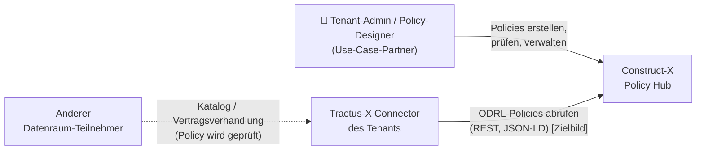

| Kommunikationspartner | Eingabe an den Policy Hub | Ausgabe des Policy Hubs |
|---|---|---|
| **Tenant-Admin / Policy-Designer** | Policy-ID, Kategorie, Constraints, logische Verknüpfung | Policy-Übersicht, Detailansicht, Erläuterung der Constraints, ODRL-Vorschau |
| **Tractus-X Connector** des Tenants **[Zielbild]** | Abruf einer Policy | ODRL-`PolicyDefinition` |

Jeder Tenant betreibt seinen eigenen Connector (Control Plane und Data Plane). Der Connector holt
die Policies über die REST·ODRL-API beim Policy Hub ab; der Hub greift nicht auf die Connectoren zu
(siehe [ADR-03](#adr-03-connector-kopplung)). Die Auswertung der Policies bleibt Aufgabe des Connectors.

### Technischer Kontext

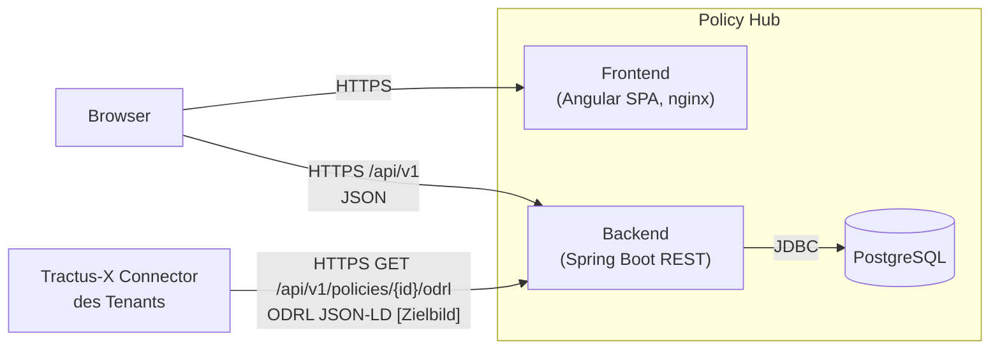

| Schnittstelle | Protokoll / Format | Status |
|---|---|---|
| Web-Oberfläche | HTTPS, Angular SPA über nginx | umgesetzt |
| REST-API `/api/v1/policies` | HTTPS, JSON; OpenAPI unter `/v3/api-docs` | umgesetzt |
| ODRL-Export `/api/v1/policies/{id}/odrl` | HTTPS, JSON-LD (EDC-`PolicyDefinition`) | umgesetzt |
| Authentifizierung | HTTP Basic (Provisorium) → Tenant Auth | **[Zielbild]**, Verfahren nicht entschieden |
| Connector → Policy Hub (Abruf) | HTTPS, ODRL JSON-LD; Authentifizierung noch offen | **[Zielbild]** |

Der verbindliche Schnittstellenvertrag ist in [`docs/api-contract.md`](../api-contract.md)
dokumentiert.

---

## 4. Lösungsstrategie

| Qualitätsziel / Anforderung | Lösungsansatz | Details |
|---|---|---|
| **Korrektheit der ODRL-Ausgabe** | Domänenmodell und ODRL sind getrennt; ODRL wird beim Abruf aus dem validierten Domänenmodell erzeugt. Unbekannte Constraints führen zu einem Fehler (`422`), statt still entfernt zu werden. | [8.1](#81-policy--und-constraint-modell), [8.2](#82-odrl-abbildung) |
| | Doppelte Validierung: Frontend (sofortiges Feedback) und Backend (verbindlich). | [8.3](#83-validierung) |
| **Änderbarkeit des Policy-Modells** | Constraints als `jsonb` gespeichert — neue Constraint-Typen erfordern keine Schemamigration. Constraint-Wissen ist an wenigen Stellen gebündelt (Validator, Mapper, Metadaten-Registry). | [ADR-01](#adr-01-persistenz-postgresql-mit-jsonb), [ADR-05](#adr-05-domänenmodell-getrennt-von-odrl) |
| **Mandantentrennung** **[Zielbild]** | Tenant-Kontext aus der Anmeldung, Trennung auf Datenbankebene (Schema pro Tenant). | [ADR-02](#adr-02-multi-tenancy) |
| **Bedienbarkeit** | Geführter Policy-Builder mit Constraint-Palette und fachlichen Bezeichnungen; Erläuterung der Constraints und ODRL-Vorschau auf der Detailseite. | [5.4](#54-ebene-3--policy-builder-whitebox) |
| **Barrierefreiheit** | Barrierefreiheit als Konvention im Design-System (`con-x-*`), statische Prüfung per ESLint. | [8.9](#89-barrierefreiheit) |
| **Unabhängige Entwicklung** | Gemeinsamer API-Vertrag; Frontend mit MirageJS-Mocks gegen dieselben Endpunkte. | [ADR-06](#adr-06-gemeinsamer-api-vertrag-und-mock-first-frontend) |
| **Leichtgewichtiger Betrieb** | Modularer Monolith (ein Backend-Service), GitOps-Deployment. | [ADR-04](#adr-04-modularer-monolith), [7](#7-verteilungssicht) |

---

## 5. Bausteinsicht

### 5.1 Zielbild

Das folgende Bild zeigt das vom Arbeitspaket vorgesehene Zielbild des Policy Hubs als
Multi-Tenant-SaaS:

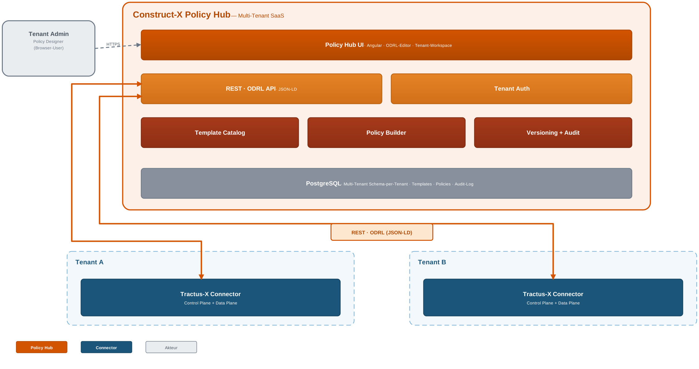

Abgleich des Zielbilds mit dem umgesetzten Stand:

| Baustein im Zielbild | Umgesetzter Stand |
|---|---|
| Policy Hub UI (Angular, ODRL-Editor) | **umgesetzt** — ohne Tenant-Workspace |
| REST · ODRL API (JSON-LD) | **umgesetzt** — Policy-CRUD und ODRL-Export |
| Policy Builder | **umgesetzt** — Builder im Frontend, Validierung in Frontend und Backend |
| PostgreSQL (Schema pro Tenant) | **teilweise** — eine gemeinsame Datenbank ohne Mandantentrennung |
| Tenant Auth | **[Zielbild]** — aktuell HTTP Basic als Provisorium |
| Template Catalog (Katalog der Constraint-Typen) | **umgesetzt** — Constraint-Palette und Metadaten-Registry im Frontend, `ConstraintType` im Backend; wird schrittweise um die Constraints des finalen Policy-Modells erweitert |
| Versioning + Audit | **teilweise** — Versionierung der Anwendung über Image-Tags (siehe [7.2](#72-build--und-deployment-pipeline-gitops)); Audit **[Zielbild]** |
| Kopplung an die Tractus-X Connectoren der Tenants | **[Zielbild]** — der Abruf-Endpunkt (`/odrl`) ist vorhanden, der Abruf durch den Connector nicht |

### 5.2 Ebene 1 — Policy Hub (Whitebox)

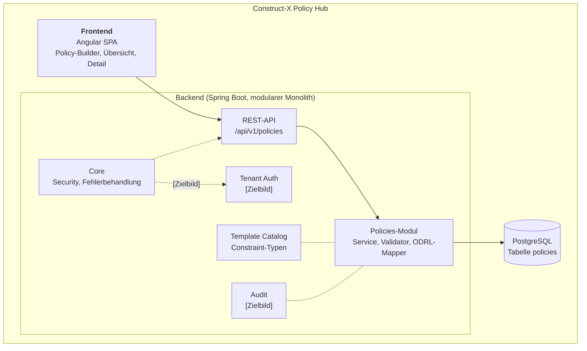

| Baustein | Verantwortung |
|---|---|
| **Frontend** | Bedienoberfläche: Policies auflisten, anzeigen, erstellen, bearbeiten, löschen; Erläuterung der Constraints erzeugen; ODRL-Vorschau anzeigen. Zweisprachig (DE/EN). |
| **REST-API** | HTTP-Schnittstelle gemäß API-Vertrag, OpenAPI-Beschreibung, Paginierung. |
| **Policies-Modul** | Fachlogik: Validierung, Eindeutigkeit der Policy-ID, Persistenz, Abbildung auf ODRL. |
| **Core** | Querschnitt: Authentifizierung/Autorisierung (aktuell HTTP Basic), einheitliches Fehlerformat. |
| **Tenant Auth** **[Zielbild]** | Anmeldung der Nutzer und Zuordnung zum Tenant. |
| **PostgreSQL** | System of Record für Policies. |
| **Template Catalog** | Katalog der verfügbaren Constraint-Typen, aus denen Policies zusammengestellt werden (Backend: `ConstraintType`, Frontend: Metadaten-Registry und Constraint-Palette). Für alle Tenants gleich. |
| **Audit** **[Zielbild]** | Nachvollziehbares Änderungsprotokoll; Einträge werden 12 Monate aufbewahrt. |

### 5.3 Ebene 2

#### 5.3.1 Backend (Whitebox)

Das Backend ist nach Feature-Modulen geschnitten; innerhalb des Moduls `policies` gilt eine
Schichtung in `api` → `application` → `domain` ← `infrastructure`.

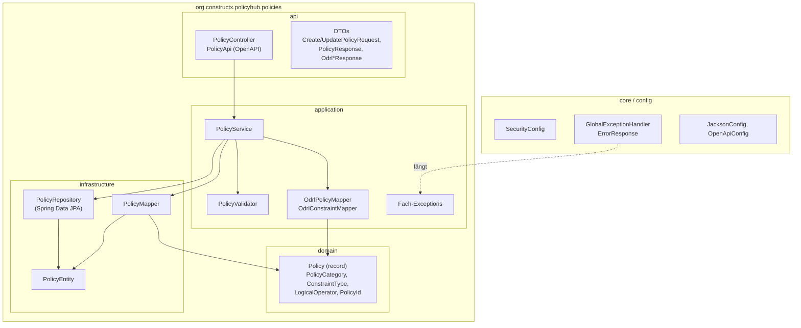

| Baustein | Verantwortung |
|---|---|
| `PolicyController` / `PolicyApi` | REST-Endpunkte, Request-Validierung (Bean Validation), OpenAPI-Annotationen. |
| `PolicyService` | Anwendungsfälle (Liste, Detail, Anlegen, Ändern, Löschen, ODRL-Export), Transaktionsgrenzen, stabile Sortierung (Tie-Breaker `id`). |
| `PolicyValidator` | Fachliche Prüfung der Constraints je Typ, inkl. Sonderregel für laufende Zeiträume beim Ändern. |
| `OdrlPolicyMapper` / `OdrlConstraintMapper` | Abbildung des Domänenmodells auf eine ODRL-`PolicyDefinition` (siehe [8.2](#82-odrl-abbildung)). |
| `domain` | Unveränderliche Domänentypen, frei von Framework-Abhängigkeiten. |
| `infrastructure` | JPA-Entity, Repository und Mapper Entity ↔ Domäne (handgeschrieben). |
| `core` | Sicherheitskonfiguration, globales Fehlerformat. |

#### 5.3.2 Frontend (Whitebox)

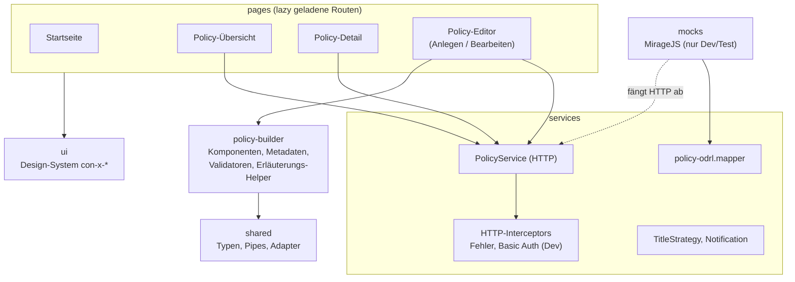

| Baustein | Verantwortung |
|---|---|
| `pages/home` | Einstieg, Kennzahlen, zuletzt bearbeitete Policies. |
| `pages/policies/policies-overview-page` | Paginierte Übersicht (serverseitig), Suche/Filter auf der geladenen Seite, Löschen. |
| `pages/policies/policy-detail-page` | Fachliche Darstellung, Erläuterung der Constraints, ODRL-Vorschau (lazy über `/odrl`). |
| `pages/policies/policy-editor-page` | Anlegen und Bearbeiten, eingebetteter Policy-Builder. |
| `services/policies/policy.service.ts` | Dünner HTTP-Client für die REST-API, keine Fachlogik. |
| `services/policies/policy-mapper/policy-odrl.mapper.ts` | ODRL-Abbildung im Frontend (für Mock-Modus, paritätisch zum Backend). |
| `services/http` | Einheitliche Fehlerbehandlung, Dev-Basic-Auth. |
| `ui` | Wiederverwendbare, barrierefreie Komponenten (`con-x-button`, `con-x-policy-table`, Snackbar, Dialoge …). |
| `mocks` | MirageJS-Server mit Testdaten (`empty`/`few`/`many`); nicht im Produktions-Bundle. |

### 5.4 Ebene 3 — Policy-Builder (Whitebox)

Der Policy-Builder ist der fachliche Kern der Oberfläche. Er ist in drei Abschnitte gegliedert:
**Identität** (Policy-ID), **Kategorie** (Zugriff/Vertrag) und **Constraints** (Auswahl,
Konfiguration, logische Verknüpfung).

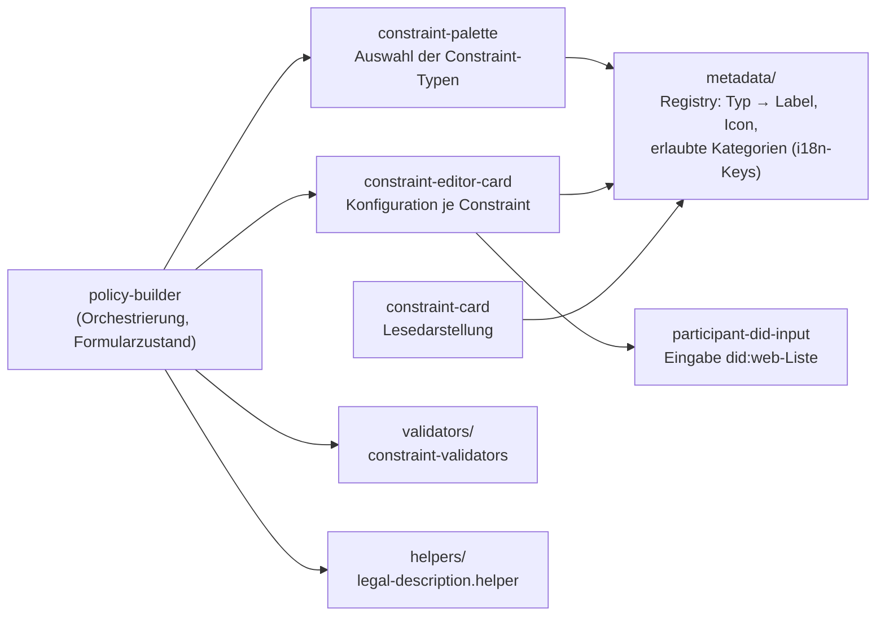

| Baustein | Verantwortung |
|---|---|
| `policy-builder` | Hält den Entwurf als Signal-State, steuert die Abschnitte, löst Validierung beim Absenden aus und fokussiert das erste fehlerhafte Feld. |
| `constraint-palette` | Zeigt die verfügbaren Constraint-Typen als Toggles; jeder Typ darf höchstens einmal vorkommen. |
| `constraint-editor-card` | Typspezifische Eingabemaske (Datum, Rahmenvertrag, Teilnehmerliste …). |
| `participant-did-input` | Erfasst mehrere `did:web`-Identifier (Einfügen mehrerer Werte, Duplikat- und Formatprüfung). |
| `metadata` | Zentrale Registry je Constraint-Typ — einzige Stelle, an der ein neuer Typ in der UI registriert wird. |
| `validators` | Reine Funktionen, liefern `{ field, messageKey }`; spiegeln die Backend-Regeln. |
| `legal-description.helper` | Erzeugt die deutschsprachige Erläuterung der Constraints aus Kategorie, Constraints und logischer Verknüpfung. |

---

## 6. Laufzeitsicht

### 6.1 Policy anlegen

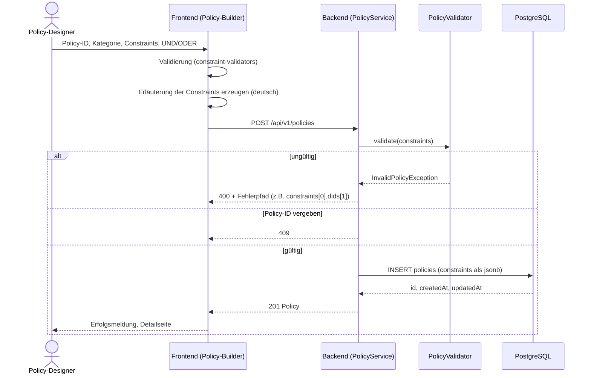

Die Erläuterung der Constraints wird im Frontend erzeugt und vom Backend unverändert gespeichert (siehe
[ADR-07](#adr-07-erläuterung-der-constraints-wird-im-frontend-erzeugt)).

### 6.2 Policy bearbeiten

Der Ablauf entspricht 6.1 mit `PUT /api/v1/policies/{id}` (vollständiger Request-Body). Zwei
Besonderheiten:

- **Laufende Zeiträume:** Ein Startdatum in der Vergangenheit ist beim Anlegen unzulässig. Beim
  Bearbeiten bleibt ein **unverändertes**, bereits gespeichertes Startdatum gültig — sonst wäre
  eine laufende Policy nicht mehr editierbar. Der Validator erhält dazu die gespeicherten
  Constraints.
- **Eindeutigkeit:** Die Policy-ID darf geändert werden, solange keine andere Policy sie trägt.

### 6.3 Policy ansehen und ODRL abrufen

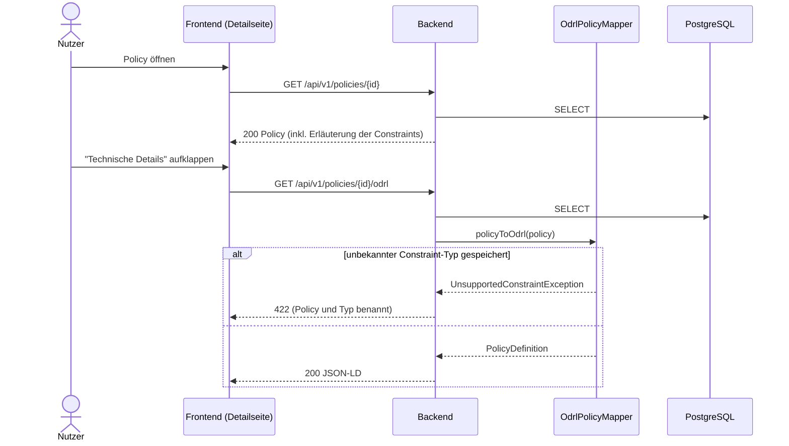

Die ODRL-Darstellung wird **bei jedem Abruf neu erzeugt**, nicht gespeichert. Damit wirkt eine
Korrektur der Abbildungsregeln sofort auf alle Policies.

### 6.4 Bereitstellung an den Connector und Policy-Evaluation

Dieser Ablauf zeigt den Weg einer Policy bis zu ihrer Auswertung. Der Connector holt die Policy
beim Hub ab. **Die Verantwortung des Policy Hubs endet mit der Auslieferung der ODRL-Policy**
(Schritte 1–2). Die Auswertung in den folgenden Schritten erfolgt ausschließlich im Connector und
ist zur Einordnung dargestellt.

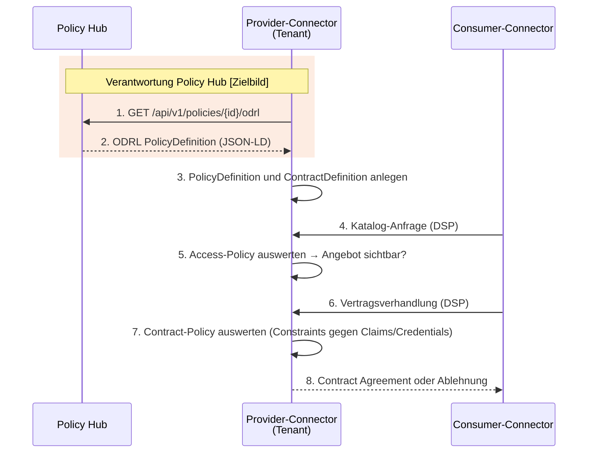

Konsequenzen für den Policy Hub:

- Die **Kategorie** bestimmt, wo der Connector die Policy einsetzt: `ACCESS` als Access-Policy
  (Katalog-Sichtbarkeit), `CONTRACT` als Contract-Policy (Nutzungsbedingungen).
- Der Connector muss die ausgegebenen Left-Operands und — bei `OR`-Policies — `odrl:or` mit
  verschachteltem `odrl:and` auswerten können (siehe [Risiken](#11-risiken-und-technische-schulden)).
- Der Endpunkt für Schritt 1 ist umgesetzt; der Abruf auf Connector-Seite und dessen
  Authentifizierung noch nicht.

### 6.5 Fehlerfälle

| Situation | Statuscode | Verhalten |
|---|---|---|
| Ungültige Eingabe (Format, Pflichtfeld, Constraint-Regel) | `400` | Fehlermeldung mit Feldpfad; Frontend zeigt eine übersetzte Meldung. |
| Nicht angemeldet | `401` | Von Spring Security behandelt. |
| Policy nicht gefunden | `404` | Frontend zeigt Fehlerzustand. |
| Policy-ID bereits vergeben | `409` | Frontend weist auf die Kollision hin. |
| Gespeicherter Constraint unbekannt | `422` | ODRL-Export verweigert; Policy bleibt les- und reparierbar (`PUT` ohne den Constraint). |

---

## 7. Verteilungssicht

### 7.1 Staging-Umgebung (Kubernetes)

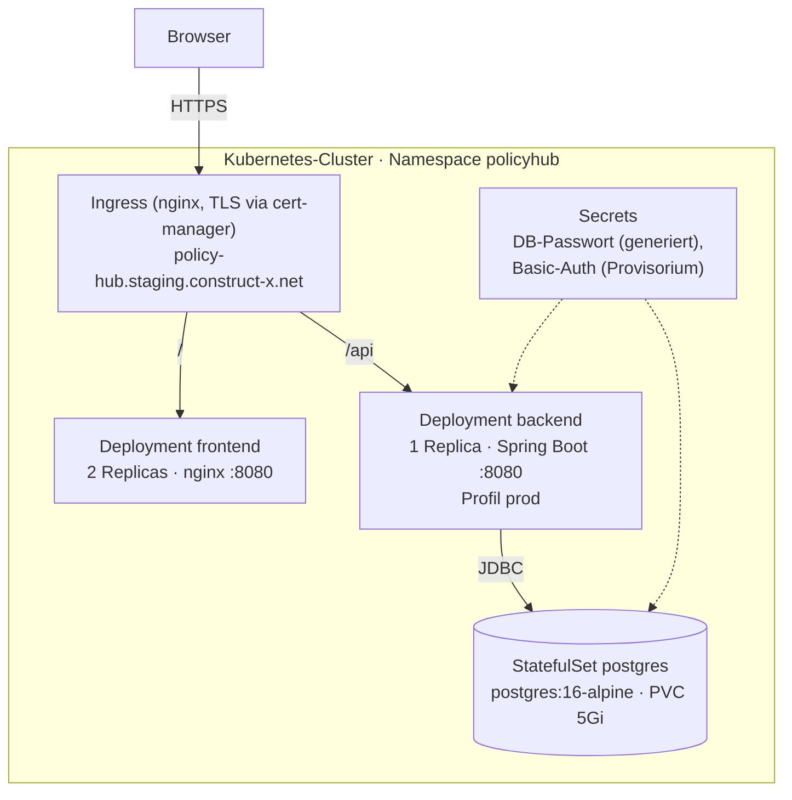

| Element | Beschreibung |
|---|---|
| **Ingress** | Leitet `/` an das Frontend und `/api` an das Backend; TLS über cert-manager. Frontend und API sind dadurch same-origin, eine CORS-Konfiguration ist nicht nötig. |
| **Frontend** | Statisch gebaute Angular-App, ausgeliefert von nginx mit SPA-Fallback. |
| **Backend** | Spring Boot mit Profil `prod`; Health-Probes (`/actuator/health/liveness`, `/readiness`) für Kubernetes. |
| **PostgreSQL** | Im Cluster als StatefulSet; per Helm-Wert gegen eine externe/gemanagte Datenbank austauschbar. |
| **Secrets** | DB-Passwort wird beim ersten Install generiert und danach stabil gehalten. Basic-Auth-Secret ist ein bewusst isoliertes Provisorium. |

### 7.2 Build- und Deployment-Pipeline (GitOps)

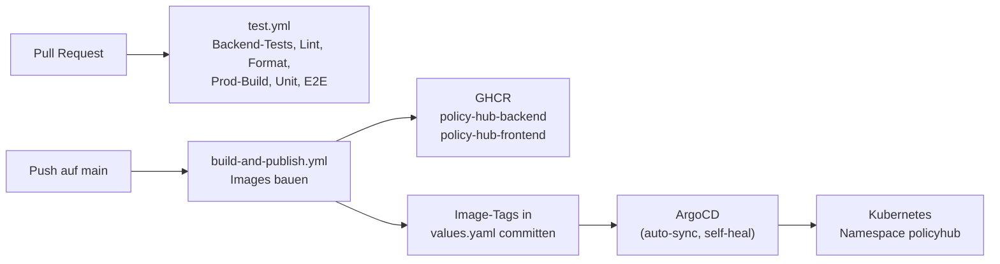

**Versionierung der Anwendung:** Jeder Build auf `main` erzeugt Container-Images, die mit dem
Commit-SHA (und `main`) getaggt werden; der ausgerollte Stand ist damit eindeutig einem Commit
zugeordnet. Release-Versionen sind noch nicht eingeführt.

### 7.3 Lokale Entwicklung

| Variante | Zusammensetzung |
|---|---|
| `docker compose up --build` (Repo-Root) | PostgreSQL, Backend und Frontend (Dev-Server) — voller Stack ohne Mocks. |
| `npm start` (Frontend) | Frontend allein mit MirageJS-Mocks. |
| `./gradlew bootRun` (Backend) | Backend gegen lokales PostgreSQL; Swagger UI unter `/swagger-ui.html`. |

### 7.4 Produktivbetrieb als Multi-Tenant-SaaS **[Zielbild]**

Laut Zielbild wird eine zentrale Instanz des Policy Hubs als Multi-Tenant-SaaS betrieben. Die
Tenants betreiben ihre Tractus-X Connectoren in ihrer eigenen Infrastruktur; die Connectoren holen
ihre Policies per REST/ODRL beim Policy Hub ab. Gegenüber der Staging-Umgebung kommen Tenant Auth
und die Mandantentrennung in PostgreSQL (Schema pro Tenant) hinzu. Betreiber und Hosting-Ort sind
noch offen.

---

## 8. Querschnittliche Konzepte

### 8.1 Policy- und Constraint-Modell

> ⚠️ Das finale Construct-X-Policy-Modell wird **schrittweise eingeführt**. Kategorien und
> Constraint-Typen ändern sich daher noch.

Eine Policy besteht aus:

| Feld | Bedeutung |
|---|---|
| `id` | Technische UUID (Backend-generiert), Ressourcen-Identifier in URLs. |
| `policyId` | Fachliche, eindeutige Kennung mit festem Präfix `con-x-ph-`; wird zum ODRL-`@id`. |
| `category` | `ACCESS` (Zugriff/Katalog-Sichtbarkeit) oder `CONTRACT` (Nutzungsbedingungen). |
| `constraints` | Geordnete Liste fachlicher Constraints; jeder Typ höchstens einmal. |
| `logicalOperator` | `AND` oder `OR` — Verknüpfung der Constraints. |
| `legalText` | Deutschsprachige Erläuterung der Constraints. |
| `createdAt`, `updatedAt` | Zeitstempel. |

Aktuell unterstützte Constraint-Typen (Template Catalog):

| Typ | Fachliche Bedeutung | Eingabe |
|---|---|---|
| `MEMBERSHIP` | Nur aktive Mitglieder des Datenraums | fester Wert `active` |
| `DATE_RANGE` | Nur innerhalb eines Zeitraums | Start- und Enddatum |
| `FRAMEWORK_AGREEMENT` | Rahmenvertrag muss akzeptiert sein | Vertragsbezeichnung |
| `PARTICIPANT_DID` | Nur bestimmte Teilnehmer | Liste von `did:web`-Identifiern |

Constraints werden im Domänenmodell als **diskriminierte Union** (Feld `type`) modelliert. Im
Frontend erzwingt ein exhaustiver `switch` die Behandlung jedes Typs; im Backend weist die
Validierung unbekannte Typen ab.

### 8.2 ODRL-Abbildung

Die Abbildung erfolgt in `OdrlPolicyMapper`/`OdrlConstraintMapper` (Backend) und paritätisch in
`policy-odrl.mapper.ts` (Frontend, für den Mock-Modus).

| Domäne | ODRL |
|---|---|
| `policyId` | `@id` der `PolicyDefinition` |
| `ACCESS` / `CONTRACT` | Aktion `access` (Construct-X) bzw. `odrl:use` |
| `MEMBERSHIP` | `cx:Membership` `odrl:eq` `active` |
| `DATE_RANGE` | `cx:DataUsageStartDate` `odrl:gteq` Start **und** `cx:DataUsageEndDate` `odrl:lteq` Ende |
| `FRAMEWORK_AGREEMENT` | `cx:FrameworkAgreement` `odrl:eq` Wert |
| `PARTICIPANT_DID` | `edc:connector` `odrl:eq` kommaseparierte DID-Liste |

Regeln für die logische Verknüpfung:

- `AND`: alle atomaren Constraints flach in einem `odrl:and`.
- `OR`: ein Operand je Constraint in `odrl:or`; ein Constraint mit mehreren atomaren Teilen
  (`DATE_RANGE`) wird in ein inneres `odrl:and` gekapselt, damit „Start **und** Ende“ erhalten bleibt.
- Ohne Constraints entfällt `odrl:constraint`.
- **Fail-safe:** Ein unbekannter gespeicherter Constraint wird nie übersprungen, da das Weglassen
  eines `AND`-Operanden eine weniger strenge Policy erzeugen würde. Der Export bricht mit `422` ab.

Beispiel (Kategorie `CONTRACT`, Verknüpfung `AND`, `@context` gekürzt):

```json
{
  "@context": { "...": "..." },
  "@type": "PolicyDefinition",
  "@id": "con-x-ph-example-usage",
  "policy": {
    "@context": ["...", { "...": "..." }],
    "@type": "Set",
    "odrl:permission": [{
      "odrl:action": { "@id": "odrl:use" },
      "odrl:constraint": {
        "odrl:and": [
          {
            "odrl:leftOperand": { "@id": "https://w3id.org/catenax/2025/9/policy/Membership" },
            "odrl:operator": { "@id": "odrl:eq" },
            "odrl:rightOperand": "active"
          },
          {
            "odrl:leftOperand": { "@id": "edc:connector" },
            "odrl:operator": { "@id": "odrl:eq" },
            "odrl:rightOperand": "did:web:partner-a.example.com,did:web:partner-b.example.com"
          }
        ]
      }
    }]
  }
}
```

Der vollständige, verbindliche Abbildungsvertrag steht in [`docs/api-contract.md`](../api-contract.md#odrl-representation).

### 8.3 Validierung

| Ebene | Zweck | Umsetzung |
|---|---|---|
| **Frontend** | Sofortiges Feedback, Fokus auf erstes fehlerhaftes Feld | `constraint-validators.ts` (reine Funktionen, Unit-getestet) |
| **Backend (Request)** | Struktur und Pflichtfelder | Bean Validation an den DTOs, Pattern für `policyId` |
| **Backend (fachlich)** | Verbindliche Prüfung je Constraint-Typ | `PolicyValidator` |
| **Datenbank** | Letzte Absicherung | `CHECK`-Constraints (Kategorie, Operator), `UNIQUE` auf `policy_id` |

Die Backend-Validierung ist maßgeblich; die Frontend-Regeln spiegeln sie. Fehlermeldungen nennen
den exakten Pfad (z.B. `constraints[0].dids[1]`).

### 8.4 Persistenz

- Eine Tabelle `policies`; die fachlichen Constraints liegen als **`jsonb`** in der Spalte
  `constraints` (mit GIN-Index), die übrigen Felder als relationale Spalten.
- Gespeichert wird das **Domänenmodell**, nicht das ODRL-Dokument (siehe [ADR-01](#adr-01-persistenz-postgresql-mit-jsonb)).
- Schemaänderungen ausschließlich über **Flyway** (`V1`–`V5`); Hibernate prüft nur
  (`ddl-auto: validate`).
- Transaktionsgrenzen auf Service-Ebene (`@Transactional`).

### 8.5 Sicherheit

**Umgesetzt:**

- Alle Policy-Endpunkte erfordern Authentifizierung; öffentlich sind nur Health/Info und die
  OpenAPI-Beschreibung.
- Produktions-Build des Frontends mit automatischer **Content Security Policy** und
  **Subresource Integrity**; keine externen Laufzeit-Ressourcen.
- Härtungen aus einem OWASP-Audit des Frontends: HTTP-Antworten werden als Eingabe behandelt
  (unbekannte Constraint-Typen werden aussortiert), jede ID in URLs wird kodiert, keine ungeprüften
  Werte in Übersetzungsparametern, keine Request-/Response-Bodies in Logs.
- `policyId` ist auf einen sicheren Zeichensatz beschränkt, da sie zum JSON-LD-`@id` wird.
- TLS am Ingress.

**Offen:**

- **Authentifizierung ist nicht entschieden.** HTTP Basic mit einem gemeinsamen Benutzer ist ein
  isoliertes Provisorium für Staging. Im Zielbild übernimmt der Baustein Tenant Auth die Anmeldung
  und die Zuordnung zum Tenant; das Verfahren ist noch nicht festgelegt.
- **Autorisierung** (Rollen, Tenant-Grenzen) ist nicht umgesetzt.
- **Secrets** liegen als Kubernetes-Secrets (nur base64-kodiert) vor.

### 8.6 Mandantenfähigkeit **[Zielbild]**

Der Policy Hub ist als Multi-Tenant-SaaS vorgesehen: Jeder Tenant meldet sich mit seinen eigenen
Zugangsdaten an und kann ausschließlich seine eigenen Policies erstellen, sehen und verwalten. Im
aktuellen Stand gibt es **keine Mandantentrennung**. Das Zielbild sieht ein eigenes
PostgreSQL-Schema pro Tenant vor, in dem Policies und Audit-Log des Tenants liegen (siehe
[ADR-02](#adr-02-multi-tenancy)). Der Template Catalog ist für alle Tenants gleich.

- Der Tenant wird aus der Anmeldung (Tenant Auth) abgeleitet, nie aus einem Request-Parameter.
- Jede Lese- und Schreiboperation ist auf das Schema des Tenants beschränkt.

### 8.7 Fehlerbehandlung

- Backend: einheitliches Fehlerformat (`timestamp`, `status`, `error`, `message`, `path`) über
  einen zentralen `@RestControllerAdvice`; Fach-Exceptions werden auf Statuscodes abgebildet.
- Frontend: HTTP-Fehler werden nie verworfen; ein Interceptor und `httpErrorMessageKey()` bilden
  Statuscodes auf übersetzte Meldungen ab; Lade- und Fehlerzustände als Live-Regions.
- Clients verzweigen auf den Statuscode, nicht auf den Text der Meldung.

### 8.8 Internationalisierung und Erläuterung der Constraints

- Oberfläche zweisprachig (Deutsch Standard, Englisch) über Transloco; keine literalen UI-Texte.
- Datumsformat und Locale `de-DE`.
- Die **Erläuterung der Constraints wird immer auf Deutsch** erzeugt, unabhängig von der UI-Sprache.
  Sie beschreibt die Constraints in natürlicher Sprache.

### 8.9 Barrierefreiheit

Zielniveau ist WCAG 2.2 AA. Umgesetzt sind u.a. Skip-Link, Fokusführung bei Routenwechsel,
Seitentitel pro Route, semantische Tabellen, Tastaturbedienung aller Steuerelemente,
Live-Regions für Statusmeldungen, `prefers-reduced-motion` und Reflow bis 320 px. Statische
Prüfung über das ESLint-Preset `templateAccessibility`.

**Bewusst akzeptiertes Restrisiko:** Das Marken-Orange `#e53d17` unterschreitet für Text den
Kontrast von 4,5:1. Details in [`docs/accessibility.md`](../accessibility.md).

### 8.10 Test- und Qualitätssicherungskonzept

| Ebene | Werkzeug | Umfang |
|---|---|---|
| Backend Unit/Integration | JUnit 5, Testcontainers (PostgreSQL) | Controller, Service, Validator, Mapper |
| Frontend Unit | Vitest mit Coverage-Gate | Mapper, Validatoren, Metadaten, Helper |
| Frontend E2E | Cypress (Mock-Modus) | Hauptabläufe der Oberfläche |
| Statische Analyse | ESLint, Prettier, Angular-Bundle-Budgets | jeder Pull Request |

Alle Prüfungen laufen in der CI (`test.yml`) bei jedem Pull Request gegen `main`.

### 8.11 Logging und Monitoring

- Strukturiertes Logging über Logback; Fachoperationen werden mit IDs, nicht mit Inhalten geloggt.
- Spring Boot Actuator: `health` und `info`, Kubernetes-Probes im Profil `prod`.
- **[Zielbild]** Zentrales Monitoring/Alerting und ein fachliches Audit-Log. Audit-Einträge werden
  12 Monate aufbewahrt und danach gelöscht, da sie Nutzerkennungen enthalten.

---

## 9. Architekturentscheidungen

| ID | Entscheidung | Status |
|---|---|---|
| [ADR-01](#adr-01-persistenz-postgresql-mit-jsonb) | Persistenz: PostgreSQL mit `jsonb` | entschieden |
| [ADR-02](#adr-02-multi-tenancy) | Multi-Tenancy: Schema pro Tenant | Zielbild |
| [ADR-03](#adr-03-connector-kopplung) | Connector-Kopplung: Abruf durch den Connector | Zielbild |
| [ADR-04](#adr-04-modularer-monolith) | Modularer Monolith mit Spring Boot | entschieden |
| [ADR-05](#adr-05-domänenmodell-getrennt-von-odrl) | Domänenmodell getrennt von ODRL | entschieden |
| [ADR-06](#adr-06-gemeinsamer-api-vertrag-und-mock-first-frontend) | Gemeinsamer API-Vertrag und Mock-first-Frontend | entschieden |
| [ADR-07](#adr-07-erläuterung-der-constraints-wird-im-frontend-erzeugt) | Erläuterung der Constraints wird im Frontend erzeugt | entschieden |
| [ADR-08](#adr-08-authentifizierung) | Authentifizierung | **offen** |
| [ADR-09](#adr-09-gitops-deployment-mit-helm-und-argocd) | GitOps-Deployment mit Helm und ArgoCD | entschieden |

### ADR-01: Persistenz: PostgreSQL mit jsonb

**Status:** entschieden

**Kontext:** Policies sind semi-strukturierte Dokumente, deren Profil (Constraint-Typen) sich im
MVP noch häufig ändert. Gleichzeitig werden Transaktionen, Eindeutigkeit und ein stabiler Betrieb
benötigt.

**Entscheidung:** Für den Policy Hub MVP wird eine relationale SQL-Datenbank mit nativer
JSON-Unterstützung eingesetzt, konkret **PostgreSQL mit `jsonb`** als primärem Policy-Store
(„System of Record“).

**Begründung:**

- `jsonb` speichert semi-strukturierte Inhalte und erlaubt bei Bedarf performantes Filtern über
  JSONB-Operatoren und GIN-Indizes, ohne früh starre Schemata festzulegen. Änderungen an Profilen
  sind ohne wiederholte Schemamigrationen möglich.
- Bewährte relationale Eigenschaften: Transaktionen, MVCC (weniger Blockaden zwischen Lese- und
  Schreibzugriffen), integrierte Volltextsuche (z.B. für die Erläuterungen der Constraints).
- Im Ökosystem etabliert und gut dokumentiert, u.a. setzt der Tractus-X EDC eine
  PostgreSQL-Datenbank voraus.
- In Kombination mit einem modularen Monolithen auf Spring Boot ist SQL/JPA ein geradliniger,
  gut unterstützter Integrationspfad.

**Umsetzung:** Abweichend von der ursprünglichen Formulierung („ODRL JSON-LD in `jsonb`“) wird
nicht das ODRL-Dokument, sondern die **fachliche Constraint-Liste** als `jsonb` gespeichert; ODRL
wird beim Abruf erzeugt (siehe [ADR-05](#adr-05-domänenmodell-getrennt-von-odrl)). Die Vorteile
der Entscheidung bleiben erhalten. Schemaänderungen erfolgen über Flyway.

### ADR-02: Multi-Tenancy

**Status:** Zielbild, noch nicht umgesetzt

**Kontext:** Der Policy Hub soll als zentrale SaaS mehrere Tenants bedienen. Jeder Tenant meldet
sich mit seinen eigenen Zugangsdaten an und darf ausschließlich seine eigenen Policies erstellen,
sehen und verwalten.

**Entscheidung (Zielbild):** Mandantentrennung in PostgreSQL über ein **eigenes Schema pro
Tenant**.

**Konsequenzen:**

- Starke logische Trennung; Export und Löschung der Daten eines Tenants sind einfach.
- Flyway-Migrationen müssen für jedes Tenant-Schema ausgeführt werden.
- Das Backend benötigt ein Schema-Routing pro Request, abgeleitet aus Tenant Auth.

### ADR-03: Connector-Kopplung

**Status:** Zielbild, noch nicht umgesetzt

**Kontext:** Eine im Hub erstellte Policy muss in den Tractus-X Connector des jeweiligen Tenants
gelangen, damit der Connector sie bei Katalog-Anfragen und Vertragsverhandlungen auswerten kann.

**Entscheidung (Zielbild):** Der Connector des Tenants **holt die Policies** über die REST·ODRL-API
des Policy Hubs ab (Pull). Der Hub greift nicht auf die Connectoren zu.

**Konsequenzen:**

- Das Austauschformat ist die bereits umgesetzte ODRL-`PolicyDefinition`
  (`GET /api/v1/policies/{id}/odrl`).
- Der Hub benötigt weder Endpunkte noch Zugangsdaten der Connectoren.
- Auf Connector-Seite ruft eine eigene Komponente die Policies ab und legt sie als
  `PolicyDefinition` an; sie befindet sich in Umsetzung.
- Der Connector muss sich gegenüber dem Hub authentifizieren; das Verfahren ist noch offen
  (siehe [ADR-08](#adr-08-authentifizierung)).
- Die Policy-Auswertung bleibt vollständig im Connector; der Hub kennt keine Laufzeitentscheidungen.

### ADR-04: Modularer Monolith

**Status:** entschieden

**Entscheidung:** Ein einzelner Spring-Boot-Service, intern in Feature-Module (`policies`, künftig
z.B. `audit`) mit Schichten `api`/`application`/`domain`/`infrastructure` geschnitten.

**Begründung:** Der Fachumfang ist klein; Microservices würden Betriebs- und
Kommunikationsaufwand ohne Nutzen erzeugen. Die Modulgrenzen halten eine spätere Aufteilung offen.

### ADR-05: Domänenmodell getrennt von ODRL

**Status:** entschieden

**Entscheidung:** Gespeichert und über die REST-API ausgetauscht wird ein fachliches
Domänenmodell (Kategorie, Constraints, Verknüpfung). ODRL wird ausschließlich beim Abruf von
`/odrl` durch einen Mapper erzeugt.

**Begründung:** Das ODRL-Profil (Namespaces, Left-Operands) ist an den Connector-Stack gebunden und
kann sich unabhängig vom fachlichen Modell ändern. Eine Korrektur der Abbildung wirkt sofort auf
alle Policies ohne Datenmigration. Die Oberfläche arbeitet mit fachlichen Begriffen.

**Konsequenz:** Die Abbildung existiert zweimal (Backend und Frontend-Mock) und muss paritätisch
gehalten werden; Tests sichern die Parität ab.

### ADR-06: Gemeinsamer API-Vertrag und Mock-first-Frontend

**Status:** entschieden

**Entscheidung:** Frontend und Backend sind gleichwertig und gegen einen gemeinsamen, schriftlich
fixierten [API-Vertrag](../api-contract.md) entwickelt. Das Frontend ruft stets die echten
Endpunkte auf; im Entwicklungsmodus fängt MirageJS diese ab.

**Begründung:** Frontend und Backend konnten parallel entstehen. Der Mock ist nicht im
Produktions-Bundle enthalten.

### ADR-07: Erläuterung der Constraints wird im Frontend erzeugt

**Status:** entschieden

**Entscheidung:** Die deutschsprachige Erläuterung der Constraints wird beim Speichern im Frontend
aus Kategorie, Constraints und Verknüpfung erzeugt, vom Backend unverändert gespeichert und auf der
Detailseite angezeigt.

**Begründung:** Die Textbausteine liegen bei der Oberfläche, die ohnehin die fachlichen
Bezeichnungen der Constraints verwaltet; das Backend bleibt frei von Textlogik.

**Konsequenz:** Das Backend prüft nicht, ob Erläuterung und Constraints zueinander passen (siehe
[Risiken](#11-risiken-und-technische-schulden)).

### ADR-08: Authentifizierung

**Status:** offen

**Kontext:** Aktuell schützt HTTP Basic mit einem gemeinsamen Benutzer die API (Provisorium, isoliert
in Helm-Chart und Interceptor, in einem Zug entfernbar). Im Zielbild übernimmt der Baustein Tenant
Auth die Anmeldung und die Zuordnung zum Tenant. Das konkrete Verfahren ist noch nicht festgelegt.

### ADR-09: GitOps-Deployment mit Helm und ArgoCD

**Status:** entschieden

**Entscheidung:** Ein Umbrella-Helm-Chart beschreibt Frontend, Backend und PostgreSQL; ArgoCD
synchronisiert den Cluster mit dem Repository. Die CI baut Images und schreibt die neuen Tags in
`values.yaml` zurück.

**Begründung:** Nachvollziehbarer, deklarativer Stand im Repository; Rollback über Git.

---

## 10. Qualitätsanforderungen

### 10.1 Qualitätsbaum

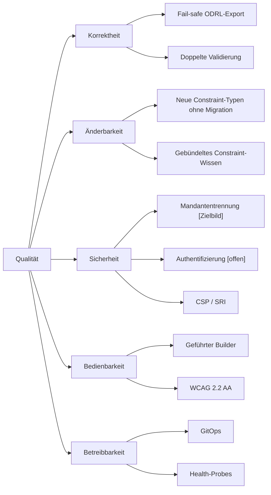

### 10.2 Qualitätsszenarien

| ID | Qualitätsziel | Szenario | Erwartete Reaktion |
|---|---|---|---|
| QS-1 | Korrektheit | In der Datenbank liegt eine Policy mit einem Constraint-Typ, den das Backend nicht mehr kennt. Die ODRL-Policy wird abgerufen. | Export wird mit `422` verweigert; es wird keine weniger strenge Policy ausgeliefert. |
| QS-2 | Korrektheit | Ein Nutzer erstellt eine `OR`-Policy aus Mitgliedschaft und Zeitraum. | Zeitraum bleibt als `odrl:and` aus Start und Ende innerhalb des `odrl:or` erhalten. |
| QS-3 | Änderbarkeit | Ein neuer Constraint-Typ wird eingeführt. | Änderung an Registry, Validatoren, Mapper und Erläuterungs-Helper; keine Datenbankmigration. |
| QS-4 | Bedienbarkeit | Ein Nutzer ohne ODRL-Kenntnisse erstellt eine Policy mit zwei Constraints. | Gelingt ohne Hilfe; fehlerhafte Eingaben werden direkt am Feld erklärt. |
| QS-5 | Barrierefreiheit | Ein Nutzer bedient den Policy-Builder ausschließlich per Tastatur und Screenreader. | Alle Funktionen erreichbar; Fehler und Statusänderungen werden angesagt. |
| QS-6 | Mandantentrennung **[Zielbild]** | Tenant A ruft die ID einer Policy von Tenant B auf. | Antwort `404`; keine Information über die Existenz der Policy. |
| QS-7 | Betreibbarkeit | Ein Commit wird auf `main` gemergt. | Neue Version läuft ohne manuellen Eingriff auf Staging. |

---

## 11. Risiken und technische Schulden

| Risiko / Schuld | Beschreibung | Maßnahme |
|---|---|---|
| **Policy-Modell im Umbau** | Das finale Construct-X-Modell wird schrittweise eingeführt; bestehende Constraint-Typen können sich ändern oder entfallen. | Constraint-Wissen gebündelt halten; für jede Änderung einen Migrationspfad für gespeicherte Policies einplanen. |
| **Authentifizierung offen** | HTTP Basic mit gemeinsamem Benutzer; kein Rollen- oder Tenant-Konzept. | Entscheidung [ADR-08](#adr-08-authentifizierung) herbeiführen; Provisorium entfernen. |
| **Keine Mandantentrennung** | Alle Nutzer sehen alle Policies. | [ADR-02](#adr-02-multi-tenancy) entscheiden und umsetzen, bevor ein zweiter Tenant produktiv arbeitet. |
| **Connector-Kompatibilität** | Der Connector muss die ausgegebenen Left-Operands und verschachtelte `odrl:or`/`odrl:and`-Constraints auswerten können. | End-to-End-Test gegen den im Datenraum eingesetzten Connector. |
| **Abhängigkeit vom Tractus-X-Policy-Namespace** | Left-Operands stammen aus einem fremden Namespace, den Construct-X nicht steuert. | Mit dem finalen Policy-Modell eigenen Namespace/Profil prüfen; ADR-05 erlaubt den Wechsel ohne Datenmigration. |
| **Doppelte ODRL-Abbildung** | Abbildung in Backend und Frontend-Mock kann auseinanderlaufen. | Paritätstests; Frontend zeigt gegen das echte Backend immer dessen Ausgabe. |
| **Erläuterung der Constraints ungeprüft** | Das Backend prüft nicht, ob Erläuterung und Constraints zusammenpassen; ein anderer API-Client könnte abweichende Texte speichern. | Bei weiteren API-Clients Erzeugung oder Prüfung serverseitig erwägen. |
| **Kein Audit-Log** | Änderungen an Policies sind nicht nachvollziehbar. | Audit gemäß Zielbild. |
| **Secrets nicht production-ready** | Kubernetes-Secrets nur base64-kodiert, keine Rotation. | Externes Secret-Management für den Produktivbetrieb. |
| **Suche/Filter nur auf geladener Seite** | Das Backend kennt keine Such-/Filterparameter. | Serverseitige Suche, sobald die Policy-Anzahl wächst. |
| **Kontrast Marken-Orange** | Text in Marken-Orange unterschreitet WCAG 1.4.3. | Bewusst akzeptiert; dunklere Textvariante als Designentscheidung möglich. |

---

## 12. Glossar

| Begriff | Definition |
|---|---|
| **Access-Policy** | Policy der Kategorie `ACCESS`; steuert im Connector, welche Teilnehmer ein Datenangebot im Katalog sehen. |
| **Connector** | Software-Komponente eines Datenraum-Teilnehmers für den souveränen Datenaustausch (hier: Tractus-X EDC). Wertet Policies aus. |
| **Constraint** | Einzelne Bedingung einer Policy (z.B. Mitgliedschaft, Zeitraum). Im Hub fachlich modelliert, in ODRL als atomarer Constraint abgebildet. |
| **Contract-Policy** | Policy der Kategorie `CONTRACT`; legt die Nutzungsbedingungen fest, die bei der Vertragsverhandlung geprüft werden. |
| **did:web** | Methode für Decentralized Identifiers, die über eine Web-Domain aufgelöst werden; identifiziert Teilnehmer im Constraint `PARTICIPANT_DID`. |
| **EDC** | Eclipse Dataspace Components — Open-Source-Framework für Datenraum-Connectoren. |
| **Erläuterung der Constraints** | Deutschsprachige, natürlichsprachliche Beschreibung der Constraints einer Policy (Feld `legalText`). |
| **JSON-LD** | JSON-basiertes Format für Linked Data; Serialisierung der ODRL-Policies. |
| **jsonb** | Binäres JSON-Format in PostgreSQL mit Index- und Abfrageunterstützung. |
| **Left-Operand** | Linke Seite eines ODRL-Constraints — die Eigenschaft, die geprüft wird (z.B. `Membership`). |
| **Management API** | REST-Schnittstelle eines Connectors zur Verwaltung von Assets, Policies und Contract Definitions. |
| **ODRL** | Open Digital Rights Language — W3C-Standard zur Beschreibung von Nutzungsrechten und -bedingungen. |
| **Policy** | Regelwerk, das Zugriff auf bzw. Nutzung von Daten an Bedingungen knüpft. |
| **PolicyDefinition** | EDC-Objekt, das eine ODRL-Policy mit einer ID kapselt und über die Management API angelegt wird. |
| **Policy-ID** | Fachliche Kennung einer Policy mit Präfix `con-x-ph-`; wird zum ODRL-`@id`. |
| **Template Catalog** | Katalog der Constraint-Typen, aus denen Policies im Policy Hub zusammengestellt werden. |
| **Tenant** | Mandant des Policy Hubs (in der Regel ein Unternehmen bzw. Use-Case-Partner) mit eigenem, abgeschottetem Policy-Bestand. **[Zielbild]** |
